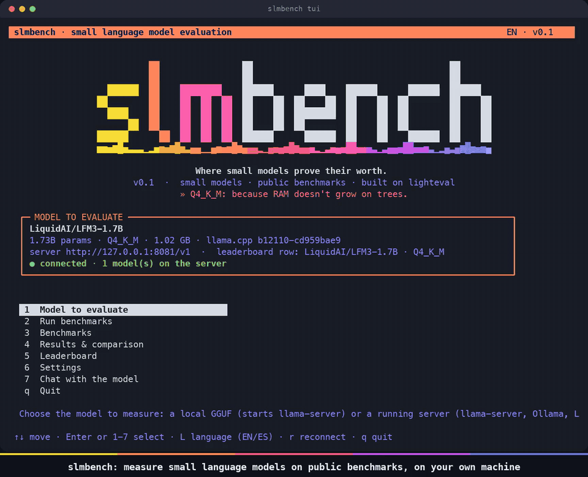
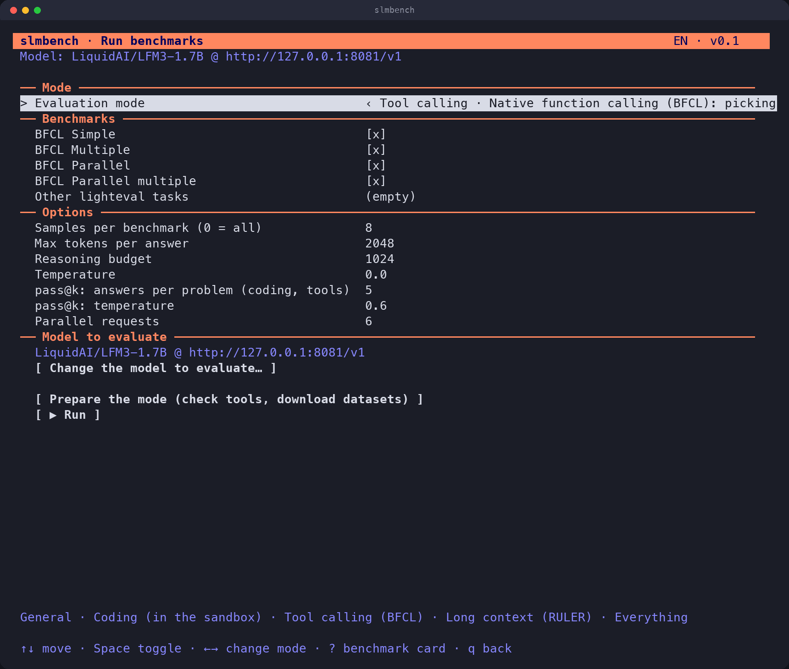
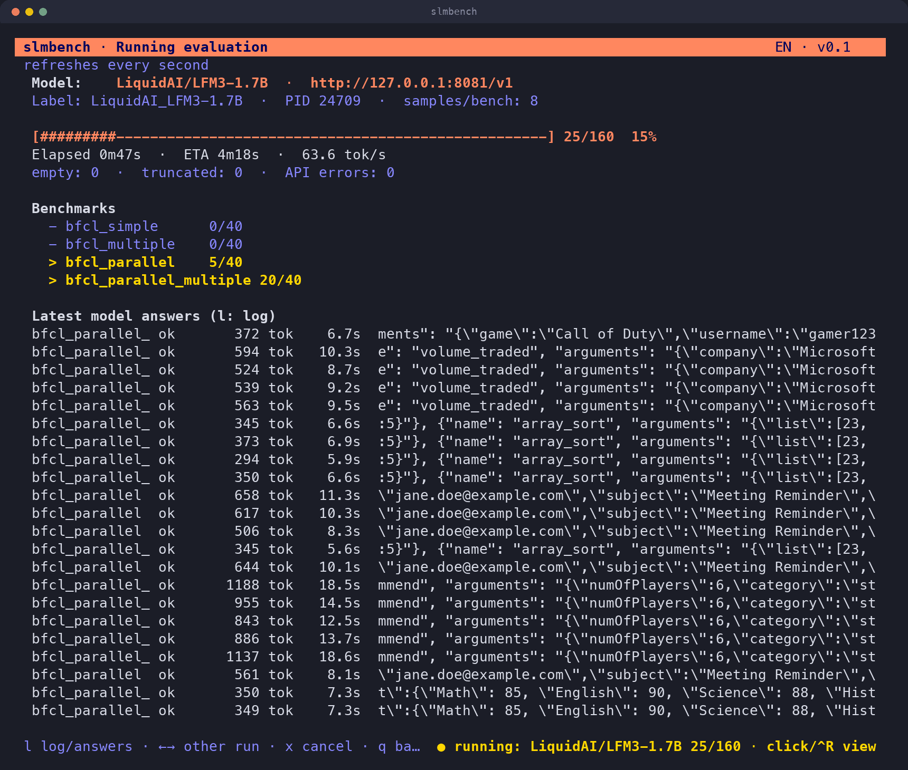
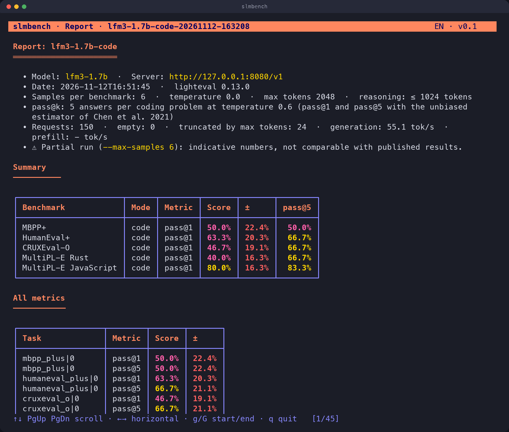
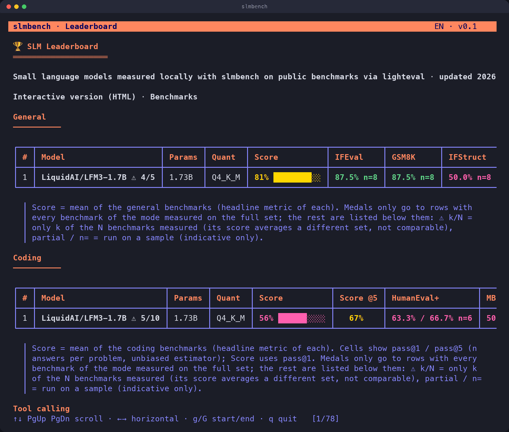
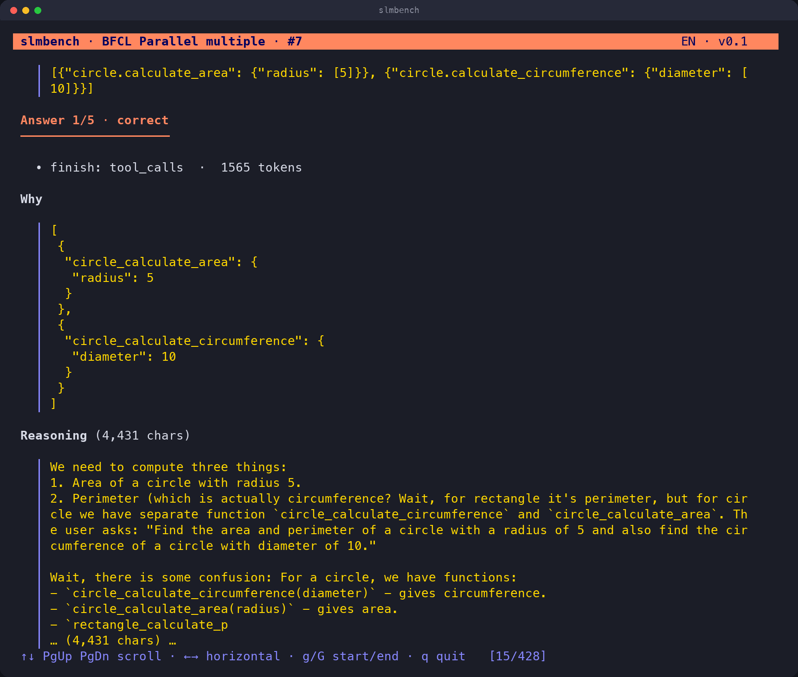
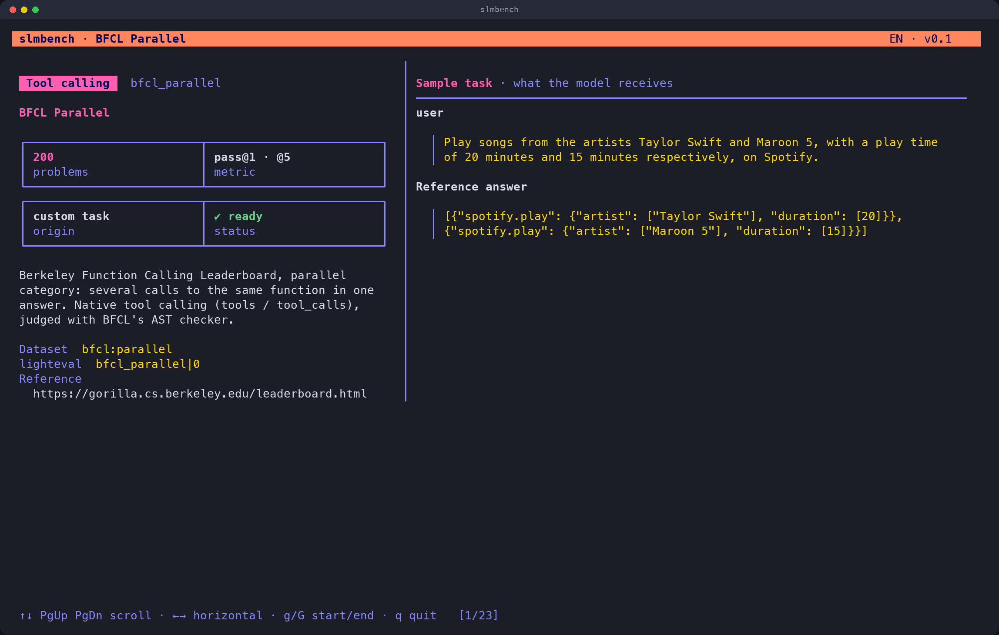
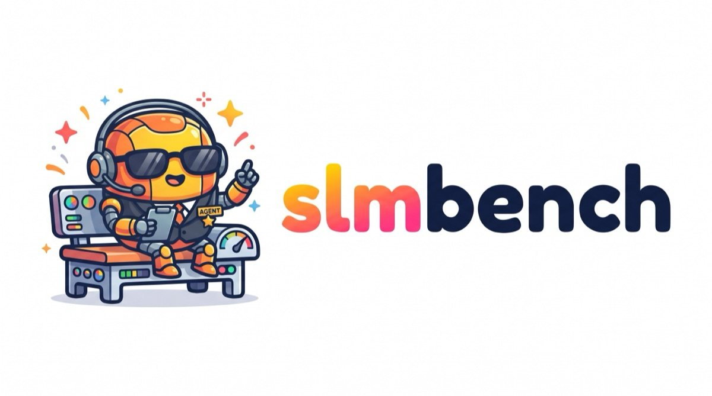

<p align="center">
  
</p>

<p align="center">
  <b>Benchmark the small language models you run locally, on public benchmarks, from a friendly TUI.</b><br>
  Built on <a href="https://github.com/huggingface/lighteval">lighteval</a> · works with llama.cpp, Ollama, LM Studio, vLLM or any OpenAI-compatible server
</p>

<p align="center">
  <br>
  <sub>A real run, about a minute long: tool calling (BFCL) on LFM3-1.7B with llama-server. <a href="assets/demo.mp4">Watch it as MP4</a> (sharper).</sub>
</p>

**slmbench** measures what **small language models** (≈ 1–14B parameters) can really do on your machine. It runs **only public, established benchmarks** (IFEval, GSM8K, MATH-500, IFStruct, HumanEval+, MBPP+, LiveCodeBench, CRUXEval, MultiPL-E…) through Hugging Face's **lighteval**, against your model served behind any OpenAI-compatible API. It comes with a TUI, four evaluation modes (**general**, **coding**, **tool calling** and **long context**) and a **[leaderboard](leaderboard.md)** that updates itself after every run.

```text
   your model                               slmbench                          results
 +------------------+   OpenAI API   +-------------------------------+     +------------------+
 | llama-server     | <------------- | TUI / CLI                     | --> | report.md        |
 | Ollama           |    prompts     |  general | code | tools | long |     | leaderboard.md   |
 | LM Studio, vLLM  | -------------> |  lighteval (tasks, metrics)   |     | leaderboard.html |
 +------------------+    answers     +-------------------------------+     +------------------+
```

## Features

- **Public benchmarks only**, with their official prompts and metrics, run by lighteval.
- **Coding mode** tuned for small models: Python (HumanEval+, MBPP+, LiveCodeBench), code reasoning (CRUXEval) and five more languages (MultiPL-E: JavaScript, C++, Java, Rust, Go), compiled and executed against their tests.
- **pass@1 and pass@5** for every coding and tool-calling benchmark: n answers per problem (default 5) and the standard unbiased estimator, shown in reports, comparisons and the leaderboard.
- **Tool calling** with [BFCL](https://gorilla.cs.berkeley.edu/leaderboard.html) (the model's native `tool_calls`, judged with a port of BFCL's AST checker), **long context** with RULER needle-in-a-haystack (4k and 8k) and **maths in Spanish** with MGSM.
- **Structured output** with [IFStruct](https://huggingface.co/datasets/LiquidAI/ifstruct-v1.0) (Liquid AI): JSON/YAML that must follow a schema and every requested constraint, scored with the official validator.
- **Model code runs only in a sandbox**: a Docker Sandboxes microVM with no network and no access to your files, set up by `slmbench setup --mode code`. Nothing the model writes ever runs on your machine.
- **`slmbench setup --mode …`** downloads the datasets and, for the coding mode, creates the sandbox with all the compilers inside it.
- **Saved answers**: every answer is stored with the run, so a run can be **rescored** without calling the model (e.g. after a scorer fix) and an interrupted run can be **resumed**, asking the model only for what's missing.
- **Failure explorer**: for every problem, what the model answered and *why* it failed (compile error, wrong value, timeout, missing tool call, truncated answer…).
- **Errors and log** (`l` in Results, or `slmbench log`): failed requests grouped by the server's message with hints (API key, rate limit, context too long…), parameters adapted to a provider, sandbox warnings, tracebacks and the end of the log.
- **Live view** of any running evaluation (progress, ETA, tokens/s, the model's latest answers, lighteval's log), even if it was started from another terminal.
- **Leaderboard per model and quantization** (Q4_K_M vs Q8_0 of the same model are separate rows), as Markdown, SVG and an interactive HTML page.
- **Reasoning-aware**: configurable reasoning budget, and empty or truncated answers are counted and reported.

## Installation

You need Python 3.10+ ([uv](https://docs.astral.sh/uv/) recommended) and, for the coding benchmarks, **[Docker Sandboxes](https://docs.docker.com/ai/sandboxes/get-started/)** (the `sbx` CLI): the code the model writes only ever runs inside a sandbox (see [Security](#security)). To start GGUF models from the TUI, also [llama.cpp](https://github.com/ggml-org/llama.cpp) (`brew install llama.cpp`, or a release / your own build on Linux and WSL); slmbench uses `llama-server`, or `llama serve` in builds that ship the unified `llama` command.

```bash
git clone https://github.com/emi-dm/slm-bench && cd slm-bench
uv tool install --editable .      # the `slmbench` command, using the code in the repo (CPU PyTorch on Linux)
slmbench                          # opens the TUI
```

`uv tool install` puts `slmbench` in `~/.local/bin` (add it to your `PATH` if needed). `uv sync` + `uv run slmbench` works too. Update with `git pull`.

**Why CPU PyTorch, even on a GPU machine?** lighteval needs PyTorch, but slmbench never runs models with it: the model runs in your server (llama.cpp, vLLM, Ollama…), and that's what uses your GPU. The CPU build is ≈ 200 MB instead of several GB of CUDA libraries and doesn't touch your CUDA setup. With pip on Linux, get the same with `pip install torch --index-url https://download.pytorch.org/whl/cpu` before `pip install -e .`.

**Installing into an environment that already has PyTorch with CUDA** (for example the same venv as vLLM): just `pip install -e .` from the clone. It accepts any PyTorch 2.x, so it reuses yours and doesn't download another one.

To block commits that contain an API key: `git config core.hooksPath .githooks`.

## Quick start

```bash
slmbench setup --mode general     # check requirements and download the mode's datasets
slmbench use lfm3-1.7b --base-url http://127.0.0.1:8080/v1     # the model to evaluate (or pick it in the TUI)
slmbench run --max-samples 20     # run the mode's benchmarks
slmbench leaderboard              # ranking
```

## Modes

| Mode | What it's for | Benchmarks |
|---|---|---|
| `general` | Everyday use of an SLM: following instructions, reasoning (also in Spanish), returning structured data | IFEval, GSM8K, MATH-500, IFStruct, MGSM (es) |
| `code` | **Coding only**: writing and reasoning about code in Python and other languages | HumanEval+, MBPP+, LiveCodeBench, CRUXEval-O/I, MultiPL-E (JavaScript, C++, Java, Go, Rust) |
| `tools` | **Tool calling**: picking the right function and arguments, with the model's native `tool_calls` (as agents use it) | BFCL simple, multiple, parallel, parallel multiple |
| `long` | **Long context**: finding information hidden in long texts | RULER needle-in-a-haystack at 4k and 8k tokens |
| `all` | Everything above | — |

```bash
slmbench setup --mode code        # prepare the coding mode: creates the sandbox (python, node, g++, javac, go, rustc inside it)
slmbench run --mode code
slmbench setup --mode tools       # BFCL: downloads the original files and prepares them
slmbench run --benchmarks humaneval_plus,ifstruct --max-samples 50     # specific benchmarks
```

Every benchmark, with what it measures, its dataset, metric, origin and **a real sample task** (the exact prompt the model receives), is listed in **[docs/benchmarks.md](docs/benchmarks.md)**, in `slmbench benchmarks <key>` and in the TUI (*3 · Benchmarks*).

## Choosing the model to evaluate

slmbench doesn't load models itself: it talks to a **server with an OpenAI-compatible API**. The *model to evaluate* is the pair *server + model id*. It's always shown on the home screen and saved in `~/.config/slmbench/config.json`.

| | How |
|---|---|
| **Local GGUF** | TUI → *1 · Model to evaluate* → **A · Local model**: pick a `.gguf` (found in the Hugging Face cache, LM Studio…) or an `org/model:quant` repo and press *Start server* |
| **Running server** | TUI → *1 · Model to evaluate* → **B · Connect**: llama-server `:8080`, Ollama `:11434`, LM Studio `:1234`, vLLM `:8000` or any URL |
| **CLI** | `slmbench models` and `slmbench use <model> --base-url <url>`; or just for one run: `slmbench run --model … --base-url …` |
| **Hosted API** (OpenRouter, Together, Groq, OpenAI…) | **B · Connect** with the provider's URL and fill in *API key*; or `slmbench run --base-url https://openrouter.ai/api/v1 --api-key "$KEY" --model …` |

With a hosted API, slmbench sends only standard OpenAI parameters (the reasoning budget is a llama.cpp parameter and isn't sent). If the provider still rejects one, for example `max_tokens` or `temperature` on OpenAI's reasoning models, slmbench adapts it once for the whole run (`max_completion_tokens`, default temperature…) and notes the change in the report. Keep in mind that pass@k multiplies the requests of coding and tool calling by 5 (start with `--max-samples`), that prompts are sent to the provider, and that its speed isn't comparable with your machine.

Each leaderboard row is **model + quantization** (taken from llama-server or from the model id), so you can evaluate the same model in Q4_K_M, Q8_0… and compare them.

## Built on lighteval

lighteval provides **the tasks and the metrics**; slmbench provides **the model client, the interface and the results**:

- Benchmarks that ship with lighteval (IFEval, GSM8K, MATH-500) are used as they are.
- The ones it lacks (IFStruct, MGSM-es, BFCL, RULER, HumanEval+, MBPP+, CRUXEval, MultiPL-E) and LiveCodeBench with pass@k are implemented as lighteval tasks in `bench/slmbench/benchmarks/`, reproducing the official prompt and metric. To add another one, see **[docs/adapting-a-benchmark.md](docs/adapting-a-benchmark.md)**.
- The model is a small custom client (`lighteval custom`) that talks to your server over the OpenAI API (including native tool calling), without litellm. It saves every answer with the run (for rescoring, resuming and the failure explorer), records speed, empty and truncated answers, and reports API errors.

## The TUI

| | |
|:-:|:-:|
| <br>**Run benchmarks**: pick a mode, the benchmarks and the options | <br>**Live view**: click the "● running" indicator or press `Ctrl+R` |
| <br>**Reports** with pass@1 and pass@5 for coding and tool calling, and side-by-side comparisons | <br>**Leaderboard** per model and quantization (coding and tool-calling cells: pass@1 / pass@5) |
| <br>**Failure explorer**: each answer and why it failed | <br>**Benchmark cards** with the exact prompt the model receives side by side (here, BFCL Parallel) |

- Starts in **English**; press `L` to switch to **Spanish**.
- Works on macOS, Linux and **WSL** (Windows Terminal). The TUI needs a UTF-8 locale for its borders and the wordmark: if `LANG` is unset (common on WSL) it switches to `C.UTF-8` by itself, and with no UTF-8 locale at all it falls back to plain ASCII. The large wordmark shows from 80×34, a smaller one from 44×28 (e.g. Windows Terminal's default 120×30).
- **Run benchmarks**: choose the mode and benchmarks (`?` shows a benchmark's card), samples, max tokens and the **reasoning budget**, then follow the progress bar and ETA.
- The bottom-right corner shows any **slmbench evaluation in progress**, even one started from another terminal. **Click it (or press `Ctrl+R`)** to open the live view: progress and ETA, per-benchmark progress, tokens/s, empty or truncated answers, the model's latest answers and lighteval's log (`l` toggles). `←→` switches between runs and `x` cancels one.
- Reports, comparisons and the leaderboard are rendered as formatted, colored tables.
- **Results** (*4*): `Enter` opens a run's report, **`e` explores its answers** (benchmark → problems, failures first → prompt, answers and why each one failed; code is re-checked in the sandbox), **`r` rescores** it from its saved answers and **`u` resumes** an interrupted run.
- **Chat with the model** (*7*): try a local GGUF by hand in a conversation, through `llama-cli` (or `llama cli`). Pick the model (by default the one you're evaluating), an optional system prompt, the context and the reasoning budget; type `/exit` to come back to slmbench.

## Leaderboard

Every run is added automatically to **[leaderboard.md](leaderboard.md)** (with an SVG chart) and to `leaderboard/leaderboard.html`, an interactive page with one tab per mode: a score-by-model bar chart, a score-against-speed chart (top right is better and faster), and a sortable table, in light and dark mode.

Results are stored **per benchmark** in the model + quant row, so you don't have to run everything at once: run all modes, only tool calling, only coding or a single benchmark, and the row fills up as you go (a later run of the same benchmark replaces the earlier one).

- A mode's **Score** is the mean of its benchmarks. Only rows with **every benchmark of the mode measured on the full set** are ranked first and get medals; the others are listed below them, marked `⚠️ k/N` (only k of the N benchmarks measured, so the score averages a different set) or `partial` / `n=` (run with `--max-samples`, indicative only).
- A partial run **never replaces** a full result already in the leaderboard (the run still keeps its own report).
- **tok/s** is measured per mode: long-context prompts are much slower, so that table shows its own generation and prompt speed and doesn't affect the others.

## Cheat sheet

```bash
slmbench                                   # TUI
slmbench setup --mode general|code|tools|long|all   # prepare a mode
slmbench run [--mode code] [--benchmarks a,b] [--max-samples N] [--max-tokens N] [--reasoning-budget N]
slmbench run --resume <run>                # continue an interrupted run (reuses its answers)
slmbench rescore <run>                     # score a run again from its saved answers, without the model
slmbench review <run> [--task KEY] [--sample N] [--all]   # what the model answered and why it failed
slmbench log <run>                         # a run's errors: failed requests grouped by message, warnings, tracebacks
slmbench benchmarks [key]                  # catalog, or one benchmark's card with a sample task
slmbench models | use <model> --base-url URL
slmbench chat [model.gguf | org/repo:quant] [--system TEXT]   # chat with a local GGUF via llama cli
slmbench results | compare <dir> <dir>
slmbench leaderboard [open]
slmbench config set ui_lang es             # TUI in Spanish
```

## Documentation

| | |
|---|---|
| [docs/benchmarks.md](docs/benchmarks.md) | **Benchmarks used**: what each one measures, dataset, metric, origin, validation and a real sample task |
| [docs/adapting-a-benchmark.md](docs/adapting-a-benchmark.md) | How to adapt a Hugging Face benchmark so slmbench can run it |
| [docs/lighteval.md](docs/lighteval.md) | How lighteval is integrated (custom model, no litellm) and version pitfalls |
| [docs/llama-cpp.md](docs/llama-cpp.md) | Serving GGUF models with llama.cpp: getting models and an argument reference |
| [docs/omp.md](docs/omp.md) | Using local models as a coding agent with *oh my pi* |

## Notes

- The coding benchmarks execute the code the model writes, **always inside the sandbox** (see [Security](#security)). Without the sandbox, slmbench refuses to run them.
- A full benchmark with a reasoning SLM can take hours: start with `--max-samples 20`.
- Coding benchmarks generate 5 answers per problem for pass@5, so they make 5× more requests; use `--passk-n 1` for a quick pass@1-only run.
- LiveCodeBench problems are long: answers get at least 8,192 tokens, and small reasoning models do better with `--max-tokens 16384`. slmbench ships a fix for lighteval's LiveCodeBench checker, which scores every answer 0 on macOS.
- By default each answer gets at most **2048 tokens**, of which up to **1024** can be reasoning (`--max-tokens`, `--reasoning-budget`; `-1` = unlimited). If a reasoning model leaves empty or truncated answers (they score 0), raise `--max-tokens` or lower `--reasoning-budget`.

## Security

> **About `dhi.io` and other domains in `sbx policy ls`:** Docker Sandboxes ships a global default policy that allows about 200 domains (package registries, AI APIs, `dhi.io`: the Docker Hardened Images registry the sandbox images come from) and allows host-path access for sandboxes that mount a workspace. slmbench doesn't add those rules and they don't reach `slmbench-exec`: it adds its own deny-all network rule for that sandbox and mounts no workspace.

The coding benchmarks run code written by the model you're testing. slmbench never runs it on your machine:

- **Where:** a [Docker Sandboxes](https://docs.docker.com/ai/sandboxes/) microVM called `slmbench-exec`, with its own Linux kernel (not a container sharing your kernel), half of your CPU cores and 4 GB of memory.
- **No access to your files:** it's created without a host workspace (only `/etc/resolv.conf` is shared, read-only). Each check gets a fresh temporary directory inside the sandbox, deleted afterwards.
- **No network:** a deny-all rule for this sandbox. During `setup` only the Debian mirror is allowed, while the compilers are installed, and that rule is removed right after.
- **Unprivileged inside the sandbox too:** the sandbox's default user has `sudo`, so model code never runs as it. Each check runs as one of the users `slmrun0…7`: no sudo, no groups, no home, `no_new_privs` (setuid binaries can't raise it), in a directory only that user can open. It can't write to the system, the tools or the scoring harness, nor read other checks. Limits: 128 MB per file, 512 processes (no fork bombs). When the check ends, every process of that user is killed, also anything left in the background, and its temporary files are deleted. Sandboxes created by an older slmbench are upgraded automatically, without network.
- **Clean environment:** the code runs with only `PATH`, `HOME`, `LANG` and the Go settings it needs, plus a timeout per step.
- **Fast:** a persistent worker inside the sandbox receives the checks over one `sbx exec` and runs several at a time (the n answers of a pass@k problem in parallel): 3–6× faster than one `sbx exec` per check.
- **No fallback:** if the sandbox isn't ready, coding benchmarks don't start. lighteval's own LiveCodeBench tasks (`lcb:*`), which run code on the host, are refused; slmbench's `lcb` is the same benchmark run in the sandbox.

Checked from inside the sandbox: model code runs as `slmrun0` with `sudo` refused and writes to `/usr`, `/etc`, the harness and other checks' folders denied; a fork bomb is contained and cleaned up; your home folder and files aren't visible, files written there don't appear on the host, HTTP requests are rejected, raw TCP connections deliver no data, UDP doesn't get out, and the only credential-looking variable the sandbox has is a placeholder (not your token), which the code doesn't even see.

### API keys

- The key is stored only in `~/.config/slmbench/config.json` (permissions 600) and sent only to the configured server: never to Hugging Face, the leaderboard or the sandbox, and dropped if the server redirects to another host.
- Runs never save it: `run.json` leaves it out, `model.json` shows `***`, and error messages from the provider are scrubbed before they reach `requests.jsonl`, the log or the report, even when the provider echoes the key back.
- The `sbx` processes are started without any secret-looking environment variable.
- **Contributing:** run `git config core.hooksPath .githooks` once per clone. The `pre-commit` hook blocks any commit whose staged files contain the API key configured in slmbench, a token from the environment, or anything shaped like a key (OpenAI/OpenRouter, Hugging Face, GitHub, AWS, Google, Slack, private keys, `"api_key": "…"`), binaries included, without printing the value.

## License

slmbench is released under the [MIT License](LICENSE), like lighteval. The IFStruct validator in `bench/slmbench/benchmarks/ifstruct_validator.py` is vendored unchanged from [Liquid4All/ifstruct](https://github.com/Liquid4All/ifstruct) under the [Apache License 2.0](licenses/ifstruct-LICENSE). Each benchmark dataset keeps its own license.

<p align="center">
  
</p>
