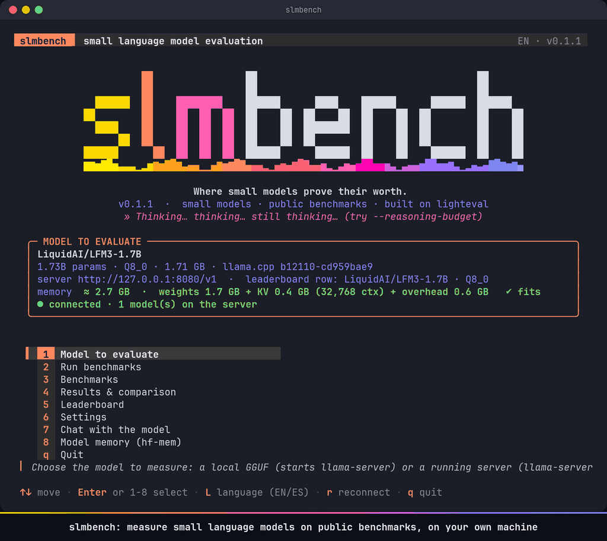
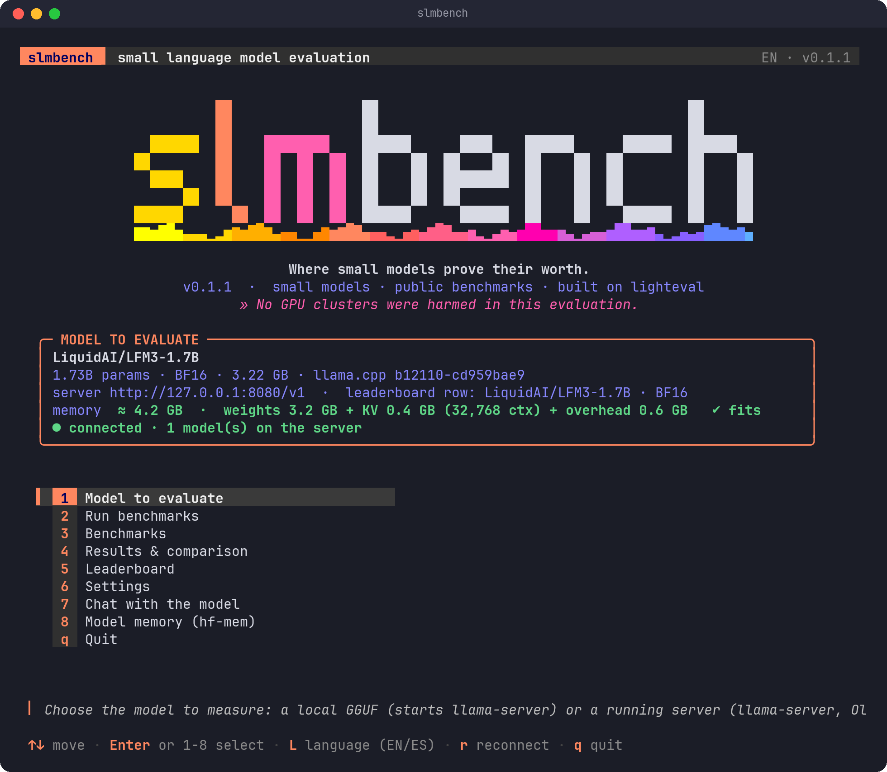
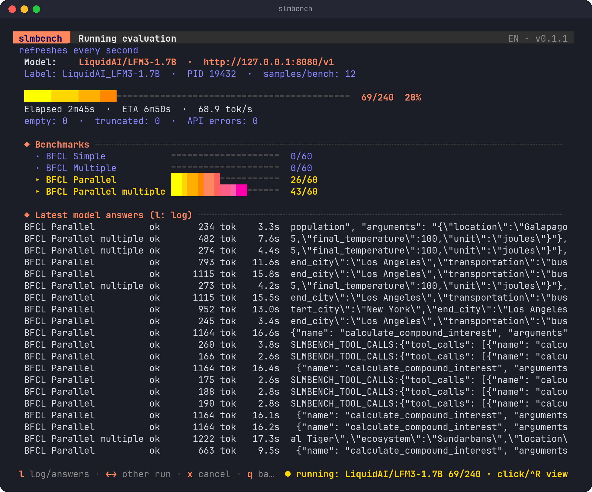
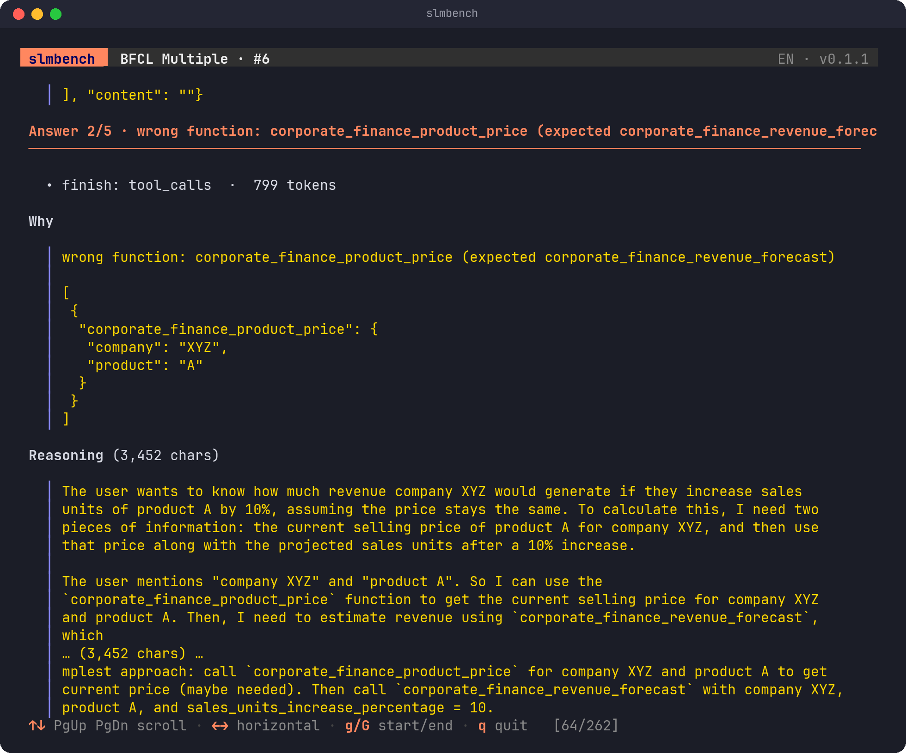
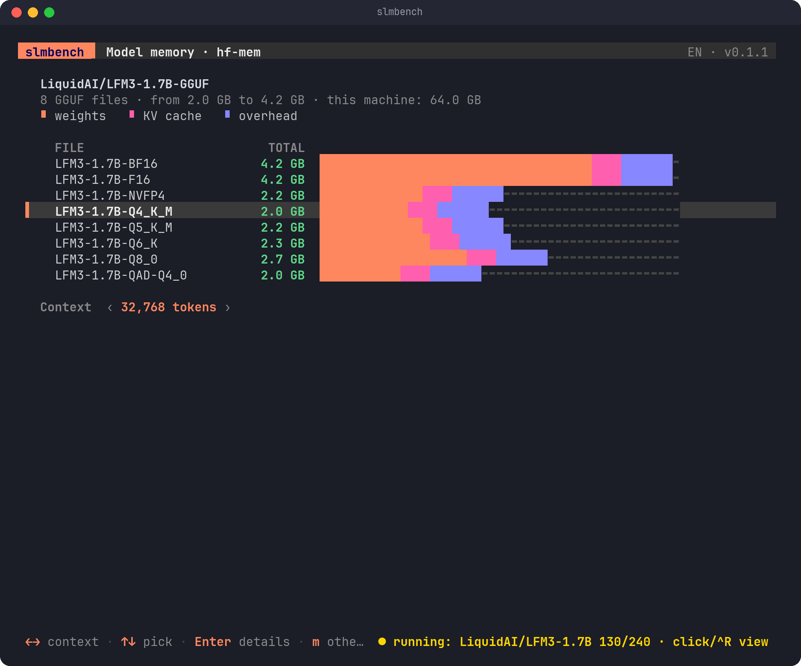

<p align="center">
  
</p>

<p align="center">
  <b>Benchmark the small language models you run locally, on public benchmarks, from a friendly TUI.</b><br>
  Built on <a href="https://github.com/huggingface/lighteval">lighteval</a> · works with llama.cpp, Ollama, LM Studio, vLLM or any OpenAI-compatible server
</p>

<p align="center">
  <br>
  <sub>A real run, about a minute long: tool calling (BFCL) on LFM3-1.7B with llama-server. <a href="assets/demo.mp4">Watch it as MP4</a> (sharper).</sub>
</p>

**slmbench** measures what **small language models** (≈ 1–14B parameters) can really do on your machine:

- **Only public, established benchmarks** (IFEval, GSM8K, MATH-500, IFStruct, BFCL, RULER, HumanEval+, MBPP+, LiveCodeBench, CRUXEval, MultiPL-E…), with their official prompts and metrics, run by Hugging Face's lighteval.
- **Four modes**: general, coding, tool calling and long context.
- **Your model, your server**: anything with an OpenAI-compatible API, local or hosted.
- **A TUI** to pick the model, run, follow the progress live, read the reports and explore every failure, plus a **[leaderboard](leaderboard.md)** that updates itself after every run.
- **Will it fit?** The memory a model needs, estimated with [hf-mem](https://github.com/alvarobartt/hf-mem) before you download it.

```text
   your model                               slmbench                          results
 +------------------+   OpenAI API   +-------------------------------+     +------------------+
 | llama-server     | <------------- | TUI / CLI                     | --> | report.md        |
 | Ollama           |    prompts     |  general | code | tools | long |     | leaderboard.md   |
 | LM Studio, vLLM  | -------------> |  lighteval (tasks, metrics)   |     | leaderboard.html |
 +------------------+    answers     +-------------------------------+     +------------------+
```

**Contents** · [Quick start](#quick-start) · [Modes](#modes) · [The TUI](#the-tui) · [Will it fit? (hf-mem)](#will-it-fit-memory-estimates-with-hf-mem) · [Choosing the model](#choosing-the-model-to-evaluate) · [Leaderboard](#leaderboard) · [Cheat sheet](#cheat-sheet) · [Browsing pi.dev](#browsing-pidev-pi--chrome-devtools-mcp) · [Built on lighteval](#built-on-lighteval) · [Tips](#tips) · [Security](#security) · [Docs](#documentation)

## Quick start

You need **Python 3.10+** ([uv](https://docs.astral.sh/uv/) recommended). Optional: **[llama.cpp](https://github.com/ggml-org/llama.cpp)** to start GGUF models from the TUI (`brew install llama.cpp`, or a release on Linux / WSL), and **[Docker Sandboxes](https://docs.docker.com/ai/sandboxes/get-started/)** (`sbx`) for the coding benchmarks, whose code only ever runs inside a sandbox.

```bash
git clone https://github.com/emi-dm/slm-bench && cd slm-bench
uv tool install --editable .      # installs the `slmbench` command (update later with `git pull`)
slmbench                          # opens the TUI
```

Then, in the TUI: **1** pick the model (a local `.gguf` or a running server) → **2** run a mode → **4** read the report → **5** check the leaderboard. Or from the command line:

```bash
slmbench setup --mode general                                  # check requirements, download the mode's datasets
slmbench use lfm3-1.7b --base-url http://127.0.0.1:8080/v1     # the model to evaluate
slmbench run --max-samples 20                                  # run the mode's benchmarks (20 problems each)
slmbench leaderboard                                           # ranking
```

<details>
<summary><b>Installation details</b>: PATH, pip, PyTorch with or without CUDA</summary>

- `uv tool install` puts `slmbench` in `~/.local/bin` (add it to your `PATH` if needed). `uv sync` + `uv run slmbench` works too.
- **Why CPU PyTorch, even on a GPU machine?** lighteval needs PyTorch, but slmbench never runs models with it: the model runs in your server (llama.cpp, vLLM, Ollama…), and that's what uses your GPU. The CPU build is ≈ 200 MB instead of several GB of CUDA libraries and doesn't touch your CUDA setup. With pip on Linux, get the same with `pip install torch --index-url https://download.pytorch.org/whl/cpu` before `pip install -e .`.
- **Into an environment that already has PyTorch with CUDA** (for example the same venv as vLLM): just `pip install -e .` from the clone. It accepts any PyTorch 2.x, so it reuses yours.
- To block commits that contain an API key: `git config core.hooksPath .githooks`.

</details>

## Modes

| Mode | What it measures | Benchmarks |
|---|---|---|
| `general` | Everyday use: following instructions, reasoning (also in Spanish), returning structured data | IFEval, GSM8K, MATH-500, IFStruct, MGSM (es) |
| `code` | Writing and reasoning about code in Python and five more languages, compiled and run against their tests | HumanEval+, MBPP+, LiveCodeBench, CRUXEval-O/I, MultiPL-E (JavaScript, C++, Java, Go, Rust) |
| `tools` | Picking the right function and arguments, with the model's native `tool_calls` (as agents use it) | BFCL simple, multiple, parallel, parallel multiple |
| `long` | Finding information hidden in long texts | RULER needle-in-a-haystack at 4k and 8k tokens |
| `all` | Everything above | — |

```bash
slmbench setup --mode code        # coding: creates the sandbox (python, node, g++, javac, go, rustc inside it)
slmbench run --mode code
slmbench setup --mode tools       # BFCL: downloads the original files and prepares them
slmbench run --benchmarks humaneval_plus,ifstruct --max-samples 50     # specific benchmarks
```

What you get from every run:

- **pass@1 and pass@5** for coding and tool calling (5 answers per problem, standard unbiased estimator).
- **Saved answers**: a run can be **rescored** without calling the model and an interrupted one **resumed**, asking only for what's missing.
- **Failure explorer**: what the model answered and *why* it failed (compile error, wrong value, timeout, missing tool call, truncated answer…).
- **Errors and log**: failed requests grouped by the server's message, with hints (API key, rate limit, context too long…).
- **Reasoning-aware**: a configurable reasoning budget; empty and truncated answers are counted and reported.

Every benchmark, with what it measures, its dataset, metric, origin and **a real sample task** (the exact prompt the model receives), is in **[docs/benchmarks.md](docs/benchmarks.md)**, in `slmbench benchmarks <key>` and in the TUI (*3 · Benchmarks*).

## The TUI

<p align="center">
  
</p>

The home screen always shows **the model you're evaluating**: its parameters, quantization, server, leaderboard row, **estimated memory** and connection. The bottom-right corner shows any evaluation in progress, even one started from another terminal; click it or press `Ctrl+R` to watch it.

| | |
|:-:|:-:|
| <br>**2 · Run benchmarks**: the mode, its benchmarks and the options | <br>**Live view**: progress, ETA, tokens/s, per-benchmark bars and the latest answers |
| <br>**4 · Reports** with pass@1 / pass@5, and side-by-side comparisons | <br>**Failure explorer** (`e`): each answer and why it failed |
| <br>**5 · Leaderboard** per model and quantization | <br>**3 · Benchmark cards** with the exact prompt the model receives |

<details>
<summary><b>Keys and screens</b></summary>

- **1 · Model to evaluate**: a local `.gguf` (slmbench starts llama-server for you) or a running server; API key; connection test.
- **2 · Run benchmarks**: mode and benchmarks (`?` shows a benchmark's card), samples, max tokens and the **reasoning budget**.
- **Live view** (`Ctrl+R`, or click "● running"): progress and ETA, per-benchmark progress, tokens/s, empty or truncated answers, the latest answers and lighteval's log (`l`). `←→` switches between runs, `x` cancels one.
- **4 · Results**: `Enter` report, **`e` explore the answers** (benchmark → problems, failures first → prompt, answers and why each one failed; code is re-checked in the sandbox), **`l` errors and log**, **`r` rescore**, **`u` resume**, `Space` + `c` compare.
- **7 · Chat with the model**: try a local GGUF by hand through `llama-cli`; `/exit` comes back.
- **8 · Model memory**: see [below](#will-it-fit-memory-estimates-with-hf-mem).
- `L` switches between **English** and **Spanish**.
- Works on macOS, Linux and **WSL** (Windows Terminal). It needs a UTF-8 locale for its borders and wordmark: if `LANG` is unset (common on WSL) it switches to `C.UTF-8` by itself, and with no UTF-8 locale at all it falls back to plain ASCII. The large wordmark shows from 80×37, a smaller one from 42×31; smaller terminals just skip it.

</details>

## Will it fit? Memory estimates with hf-mem

Before you download a model or start a long run, slmbench tells you **how much memory it needs and whether it fits on this machine**, with [hf-mem](https://github.com/alvarobartt/hf-mem): it reads the Safetensors / GGUF metadata (HTTP range requests, or the header of a local file) **without downloading the weights**, and adds up the weights, the **KV cache for your context** and the runtime overhead.

| | |
|:-:|:-:|
| <br>**8 · Model memory**: the total and whether it fits, what it's made of, and the context (`←→`) | <br>**A whole GGUF repo**: every quant side by side; `Enter` opens one |

- **On the home screen** the *memory* line shows it for the model you're evaluating, and **8 · Model memory** opens the full view. `←→` changes the context (the KV cache grows with it), `m` estimates any other model (`org/repo`, `org/repo:Q4_K_M` or a path to a `.gguf`) and `t` shows it as a table.
- **Which file?** The GGUF that llama-server is serving (when you started it from slmbench), a `.gguf` path, or a Hugging Face id. A plain id like `LiquidAI/LFM3-1.7B` is looked up as its GGUF repo first (`LiquidAI/LFM3-1.7B-GGUF`, in the quant the server reports, or Q4_K_M), since GGUF is what you serve with llama.cpp; then the repo's quants; then the original safetensors.
- **1 · Model to evaluate → A · Local model** shows the estimate live as you pick the `.gguf` and change the context (`-c`).
- From the command line:

```bash
slmbench mem LiquidAI/LFM3-1.7B-GGUF:Q4_K_M --ctx 32768     # one quant, for a 32k context
slmbench mem LiquidAI/LFM3-1.7B-GGUF                         # every quant of the repo
slmbench mem ~/models/model.gguf --json                      # a local file, as JSON
```

## Choosing the model to evaluate

slmbench doesn't load models itself: it talks to a **server with an OpenAI-compatible API**. The *model to evaluate* is the pair *server + model id*, shown on the home screen and saved in `~/.config/slmbench/config.json`.

| | How |
|---|---|
| **Local GGUF** | TUI → *1 · Model to evaluate* → **A · Local model**: pick a `.gguf` (found in the Hugging Face cache, LM Studio…) or an `org/model:quant` repo and press *Start server* |
| **Running server** | TUI → *1 · Model to evaluate* → **B · Connect**: llama-server `:8080`, Ollama `:11434`, LM Studio `:1234`, vLLM `:8000` or any URL |
| **CLI** | `slmbench models` and `slmbench use <model> --base-url <url>`; or just for one run: `slmbench run --model … --base-url …` |
| **Hosted API** (OpenRouter, Together, Groq, OpenAI…) | **B · Connect** with the provider's URL and fill in *API key*; or `slmbench run --base-url https://openrouter.ai/api/v1 --api-key "$KEY" --model …` |

Each leaderboard row is **model + quantization** (taken from llama-server or from the model id), so the same model in Q4_K_M and Q8_0 are compared side by side.

<details>
<summary><b>Hosted APIs</b>: what is sent and what to keep in mind</summary>

With a hosted API, slmbench sends only standard OpenAI parameters (the reasoning budget is a llama.cpp parameter and isn't sent). If the provider still rejects one, for example `max_tokens` or `temperature` on OpenAI's reasoning models, slmbench adapts it once for the whole run (`max_completion_tokens`, default temperature…) and notes the change in the report. Keep in mind that pass@k multiplies the requests of coding and tool calling by 5 (start with `--max-samples`), that prompts are sent to the provider, and that its speed isn't comparable with your machine.

</details>

## Leaderboard

Every run is added automatically to **[leaderboard.md](leaderboard.md)** (with an SVG chart) and to `leaderboard/leaderboard.html`: an interactive page with one tab per mode, a score-by-model chart, a score-against-speed chart and a sortable table, in light and dark mode.

- Results are stored **per benchmark** in the model + quant row: run everything, one mode or a single benchmark, and the row fills up as you go (a later run of the same benchmark replaces the earlier one).
- A mode's **Score** is the mean of its benchmarks. Only rows with **every benchmark of the mode measured on the full set** are ranked first and get medals; the others are listed below, marked `⚠️ k/N` (k of N benchmarks measured) or `partial` / `n=` (run with `--max-samples`, indicative only).
- A partial run **never replaces** a full result already in the leaderboard.
- **tok/s** is measured per mode: long-context prompts are much slower, so that table shows its own speeds.

## Cheat sheet

```bash
slmbench                                   # TUI
slmbench setup --mode general|code|tools|long|all   # prepare a mode
slmbench run [--mode code] [--benchmarks a,b] [--max-samples N] [--max-tokens N] [--reasoning-budget N]
slmbench run --resume <run>                # continue an interrupted run (reuses its answers)
slmbench rescore <run>                     # score a run again from its saved answers, without the model
slmbench review <run> [--task KEY] [--sample N] [--all]   # what the model answered and why it failed
slmbench log <run>                         # a run's errors: failed requests grouped by message, warnings, tracebacks
slmbench benchmarks [key]                  # catalog, or one benchmark's card with a sample task
slmbench models | use <model> --base-url URL
slmbench mem <org/repo[:quant] | model.gguf> [--ctx N] [--json]   # memory it needs (hf-mem), without downloading
slmbench chat [model.gguf | org/repo:quant] [--system TEXT]   # chat with a local GGUF via llama cli
slmbench results | compare <dir> <dir>
slmbench leaderboard [open]
slmbench config set ui_lang es             # TUI in Spanish
```

## Browsing pi.dev (Pi + Chrome DevTools MCP)

`slmbench browse` lets you **watch the model use a web browser**: it drives a real Chrome through the
[Chrome DevTools MCP](https://github.com/ChromeDevTools/chrome-devtools-mcp) server with the [Pi](https://pi.dev) agent as
its harness, on the **pi.dev** website. Chrome opens in a window and Pi's interface shows every step in the terminal.


*Real sessions (2× speed, [MP4](assets/browse-demo.mp4)) with LFM3-1.7B (Q4_K_M), one task each: **clicks** (open the
newest release in the Changelog), **scrolling** (PageDown to the section on Pi's modes) and **filters** (type a name, pick a
package type and press SEARCH on the Packages page).*

```bash
slmbench browse                                   # demo: type in Pi what it should do on pi.dev (Ctrl+D to leave)
slmbench browse "Open the page that lists the models"     # demo with a first task
slmbench browse --tasks my-tasks.json             # your tasks, each checked and scored; report in the results folder
```

It is not one of the benchmark modes: the tasks are yours (slmbench ships none), and the scored runs are not added to the
leaderboard. Task file format, checks and requirements (Node.js ≥ 22.19; Pi, Chrome DevTools MCP and Chrome for Testing are
installed on first use) in **[docs/browse.md](docs/browse.md)**.

## Built on lighteval

lighteval provides **the tasks and the metrics**; slmbench provides **the model client, the interface and the results**:

- Benchmarks that ship with lighteval (IFEval, GSM8K, MATH-500) are used as they are.
- The ones it lacks (IFStruct, MGSM-es, BFCL, RULER, HumanEval+, MBPP+, CRUXEval, MultiPL-E) and LiveCodeBench with pass@k are implemented as lighteval tasks in `bench/slmbench/benchmarks/`, reproducing the official prompt and metric. To add another one, see **[docs/adapting-a-benchmark.md](docs/adapting-a-benchmark.md)**.
- The model is a small custom client (`lighteval custom`) that talks to your server over the OpenAI API (including native tool calling), without litellm. It saves every answer with the run, records speed, empty and truncated answers, and reports API errors.

## Tips

- **Start small**: a full benchmark with a reasoning SLM can take hours, so try `--max-samples 20` first.
- **pass@5 costs 5×**: coding and tool calling make 5 requests per problem; `--passk-n 1` gives a quick pass@1-only run.
- **Answer length**: by default each answer gets at most **2048 tokens**, of which up to **1024** can be reasoning (`--max-tokens`, `--reasoning-budget`; `-1` = unlimited). If a reasoning model leaves empty or truncated answers (they score 0), raise `--max-tokens` or lower `--reasoning-budget`.
- **LiveCodeBench** problems are long: answers get at least 8,192 tokens, and small reasoning models do better with `--max-tokens 16384`. slmbench ships a fix for lighteval's LiveCodeBench checker, which scores every answer 0 on macOS.
- **Coding benchmarks need the sandbox**: without it, slmbench refuses to run them (see [Security](#security)).

## Security

The coding benchmarks run code written by the model you're testing. **slmbench never runs it on your machine**: it runs in a [Docker Sandboxes](https://docs.docker.com/ai/sandboxes/) microVM with its own kernel, **no network, no access to your files**, as an unprivileged user, with limits and a timeout. Your API key is only sent to the server you configured and never saved with the runs.

<details>
<summary><b>The details</b>: the sandbox, browsing and API keys</summary>

> **About `dhi.io` and other domains in `sbx policy ls`:** Docker Sandboxes ships a global default policy that allows about 200 domains (package registries, AI APIs, `dhi.io`: the Docker Hardened Images registry the sandbox images come from) and allows host-path access for sandboxes that mount a workspace. slmbench doesn't add those rules and they don't reach `slmbench-exec`: it adds its own deny-all network rule for that sandbox and mounts no workspace.

The coding benchmarks run code written by the model you're testing. slmbench never runs it on your machine:

- **Where:** a [Docker Sandboxes](https://docs.docker.com/ai/sandboxes/) microVM called `slmbench-exec`, with its own Linux kernel (not a container sharing your kernel), half of your CPU cores and 4 GB of memory.
- **No access to your files:** it's created without a host workspace (only `/etc/resolv.conf` is shared, read-only). Each check gets a fresh temporary directory inside the sandbox, deleted afterwards.
- **No network:** a deny-all rule for this sandbox. During `setup` only the Debian mirror is allowed, while the compilers are installed, and that rule is removed right after.
- **Unprivileged inside the sandbox too:** the sandbox's default user has `sudo`, so model code never runs as it. Each check runs as one of the users `slmrun0…7`: no sudo, no groups, no home, `no_new_privs` (setuid binaries can't raise it), in a directory only that user can open. It can't write to the system, the tools or the scoring harness, nor read other checks. Limits: 128 MB per file, 512 processes (no fork bombs). When the check ends, every process of that user is killed, also anything left in the background, and its temporary files are deleted. Sandboxes created by an older slmbench are upgraded automatically, without network.
- **Clean environment:** the code runs with only `PATH`, `HOME`, `LANG` and the Go settings it needs, plus a timeout per step.
- **Fast:** a persistent worker inside the sandbox receives the checks over one `sbx exec` and runs several at a time (the n answers of a pass@k problem in parallel): 3–6× faster than one `sbx exec` per check.
- **No fallback:** if the sandbox isn't ready, coding benchmarks don't start. lighteval's own LiveCodeBench tasks (`lcb:*`), which run code on the host, are refused; slmbench's `lcb` is the same benchmark run in the sandbox.

Checked from inside the sandbox: model code runs as `slmrun0` with `sudo` refused and writes to `/usr`, `/etc`, the harness and other checks' folders denied; a fork bomb is contained and cleaned up; your home folder and files aren't visible, files written there don't appear on the host, HTTP requests are rejected, raw TCP connections deliver no data, UDP doesn't get out, and the only credential-looking variable the sandbox has is a placeholder (not your token), which the code doesn't even see.

### Browsing pi.dev

`slmbench browse` gives the model a real browser, so it is limited to one website: only `pi.dev` and its subdomains resolve
in that Chrome (any other link doesn't load). The model gets only the Chrome DevTools MCP browser tools (snapshot, click,
fill, type, key, hover, navigate): no shell or file tools, and JavaScript evaluation is off. Chrome uses a throwaway profile
and never the system keyring, and Pi uses its own configuration folder (your `~/.pi` is not read).

### API keys

- The key is stored only in `~/.config/slmbench/config.json` (permissions 600) and sent only to the configured server: never to Hugging Face, the leaderboard or the sandbox, and dropped if the server redirects to another host.
- Runs never save it: `run.json` leaves it out, `model.json` shows `***`, and error messages from the provider are scrubbed before they reach `requests.jsonl`, the log or the report, even when the provider echoes the key back.
- The `sbx` processes are started without any secret-looking environment variable.
- **Contributing:** run `git config core.hooksPath .githooks` once per clone. The `pre-commit` hook blocks any commit whose staged files contain the API key configured in slmbench, a token from the environment, or anything shaped like a key (OpenAI/OpenRouter, Hugging Face, GitHub, AWS, Google, Slack, private keys, `"api_key": "…"`), binaries included, without printing the value.

</details>

## Documentation

| | |
|---|---|
| [docs/benchmarks.md](docs/benchmarks.md) | **Benchmarks used**: what each one measures, dataset, metric, origin, validation and a real sample task |
| [docs/adapting-a-benchmark.md](docs/adapting-a-benchmark.md) | How to adapt a Hugging Face benchmark so slmbench can run it |
| [docs/lighteval.md](docs/lighteval.md) | How lighteval is integrated (custom model, no litellm) and version pitfalls |
| [docs/llama-cpp.md](docs/llama-cpp.md) | Serving GGUF models with llama.cpp: getting models and an argument reference |
| [docs/browse.md](docs/browse.md) | `slmbench browse`: the model browses pi.dev with Pi + Chrome DevTools MCP (demo, or your tasks scored) |
| [docs/omp.md](docs/omp.md) | Using local models as a coding agent with *oh my pi* |

## License

slmbench is released under the [MIT License](LICENSE), like lighteval. The IFStruct validator in `bench/slmbench/benchmarks/ifstruct_validator.py` is vendored unchanged from [Liquid4All/ifstruct](https://github.com/Liquid4All/ifstruct) under the [Apache License 2.0](licenses/ifstruct-LICENSE). Each benchmark dataset keeps its own license.

<p align="center">
  
</p>
