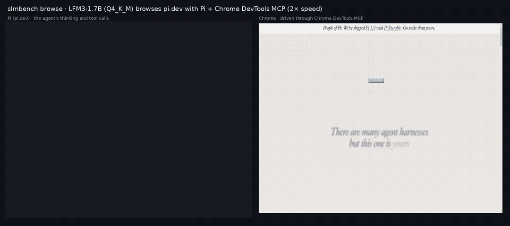

# Browsing pi.dev (`slmbench browse`)

`slmbench browse` lets you **watch a model use a web browser as an agent**. The model drives a real Chrome through the
**[Chrome DevTools MCP](https://github.com/ChromeDevTools/chrome-devtools-mcp)** server, with the **[Pi](https://pi.dev)**
coding agent as its harness, on the **pi.dev** website. Chrome opens in a window, outlining each element the agent clicks
(red), focuses (blue) or types into (green), and Pi's interface shows in the terminal what the model thinks, every tool call
and its result.



It has two uses:

| | Command | What happens |
|---|---|---|
| **Demo** | `slmbench browse` or `slmbench browse "a first task"` | Chrome shows pi.dev and Pi's interface takes the terminal. You type in Pi what the agent should do, as many times as you want. Nothing is scored. **Ctrl+D** leaves |
| **Your tasks, scored** | `slmbench browse --tasks FILE` | One episode per task of your file, each starting on a fresh tab. The agent's final reply and the address it ends on are checked; the run is saved with a report |

slmbench ships **no tasks**: the scored mode only runs the file you give it. For that reason it isn't one of the benchmark
modes and its runs are not added to the leaderboard.

## Task file

A JSON list (or one JSON object per line):

```json
[
  {"id": "short-name", "task": "What the agent should do or find on pi.dev", "answer": "text the reply must contain"},
  {"task": "Another task", "url": "pi.dev/some/page"},
  {"task": "…", "answer": ["one valid answer", "another valid answer"], "url": "docs.pi.dev", "start": "https://docs.pi.dev/"}
]
```

| Field | | Meaning |
|---|---|---|
| `task` | required | The message the agent receives (the user message in Pi) |
| `answer` | `answer` and/or `url` | Text (or list of texts, any of them) that the agent's **final reply** must contain. Case, spaces and punctuation are ignored |
| `url` | `answer` and/or `url` | Text that the browser's **final address** must contain (e.g. `pi.dev/packages`) |
| `id` | optional | A name for the task in the report (default: its number) |
| `start` | optional | The pi.dev address the task starts on (default `https://pi.dev/`) |

A task succeeds when the agent finishes with a reply (not by hitting a limit) and every check given passes.

## Watching or headless

`--tasks` runs **watched** by default: Chrome in a window and Pi's interface in the terminal. When the agent answers, its
reply stays on screen for 2 s and the next task starts. **Esc** in Pi (or closing Pi) stops the run; tasks already finished are
kept. With `--headless`, or without a display or a terminal, the same agent runs with headless Chrome and Pi in print mode.
The prompt, tools, model settings, limits and checks are the same both ways.

Output (in the results folder, `<model>-pidev-<date>/`):

- `report.md`: success rate, actions and seconds per task, and each task with the agent's reply and why it failed.
- `episodes.jsonl`: every episode: the transcript (thinking, tool calls and results, trimmed), the final address, tokens, how
  it ended (`answered`, `max_steps`, `timeout`, `setup_error`, `pi_exited`).
- `results.json` and `tasks.json` (the tasks as they were checked).

## What the agent gets

- **The model** is the one selected in slmbench (`slmbench use`, the TUI, or `--model` / `--base-url`), configured as a Pi
  provider in a folder of its own (`PI_CODING_AGENT_DIR`), so your `~/.pi` is never read or changed. Temperature, max
  tokens, reasoning budget (`thinking_budget_tokens` on llama.cpp), context and extra body are slmbench's settings.
- **The tools**: seven Chrome DevTools MCP tools, exposed directly: `take_snapshot` (the page's accessibility tree, each
  element with a `uid`), `click`, `fill`, `type_text`, `press_key`, `hover` and `navigate_page`. Pi's own tools (bash, read,
  edit, write) are off, and so is JavaScript evaluation in the MCP server (`--no-javascript-evaluation`, which also removes
  `navigate_page`'s `initScript`).
- **The prompt** (system): *"You control a web browser through Chrome DevTools tools. The browser shows the website
  https://pi.dev (Pi, a coding agent); only pi.dev and its subdomains, such as docs.pi.dev, can be opened. Do what the user
  asks using that website. Call take_snapshot to see the page: every element has a uid. Act with click, fill, type_text,
  press_key or hover using a uid from the latest snapshot, or navigate_page to go back or to open a pi.dev address, and take a
  new snapshot after the page changes. When you are done, reply with the answer in one short sentence."*
- **Limits** (scored mode): 30 tool calls and 300 s per task (or slmbench's timeout, if lower); `--max-steps` changes the first.
- **The website**: only `pi.dev` and its subdomains resolve in that Chrome (`--host-resolver-rules`); links to GitHub,
  Discord… don't load. Chrome uses a throwaway profile and never the system keyring.

## Requirements

- **Node.js ≥ 22.19** with npm (Pi's requirement), and internet access to pi.dev.
- The model server must support **native tool calls** (llama.cpp with `--jinja`, vLLM, Ollama, LM Studio…).
- Watching needs a display: on Linux `DISPLAY` or `WAYLAND_DISPLAY` (WSLg on Windows works).
- The first `slmbench browse` (or `slmbench browse --setup`) installs, into slmbench's data folder
  (`~/.local/share/slmbench/browser/`) and without touching your global npm or Chrome:

| Piece | Version |
|---|---|
| Pi (`@earendil-works/pi-coding-agent`) | 1.5.2 |
| `chrome-devtools-mcp` | 1.13.0 |
| Chrome for Testing (via `@puppeteer/browsers` 3.2.7) | 157.0.8103.78 |

## Notes

- Chrome is started with `--password-store=basic`. Without it, on Linux it asks to create or unlock a keyring (GNOME
  Keyring / KWallet) to encrypt its cookies, and it doesn't load any page until that prompt is answered.
- Pi waits at most 10 s for the MCP server before the model's first request. On a machine short of memory, starting Node can
  take longer and the model would get no tools: slmbench checks the tools Pi declares before any model call and, if the
  browser tools are missing, starts the task again (up to 3 times), otherwise it marks it `setup_error`.
- The highlight only changes the element's inline outline for a moment: the page's structure and its accessibility tree
  (what the agent sees) don't change.
- Pi runs offline (`PI_OFFLINE=1`, no version check or telemetry) and Chrome DevTools MCP's usage statistics and CrUX lookups
  are off.
