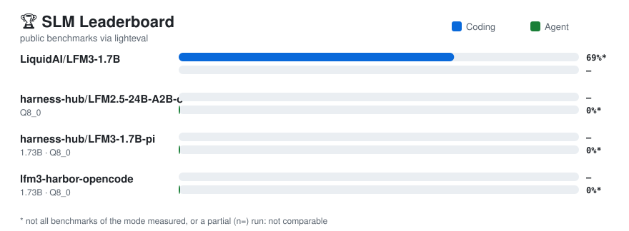

<h1 align="center">🏆 SLM Leaderboard</h1>

<i>Small language models measured locally with <b>slmbench</b> on public benchmarks via <a href="https://github.com/huggingface/lighteval">lighteval</a> · updated 2026-11-20</i>

<a href="leaderboard/leaderboard.html"><b>Interactive version (HTML)</b></a> · <a href="docs/benchmarks.md">Benchmarks</a>

## Coding

| # | Model | Params | Quant | **Score** | Score @5 | HumanEval+ | MBPP+ | LiveCodeBench | CRUXEval-O | CRUXEval-I | MultiPL-E C++ | MultiPL-E Go | MultiPL-E Java | MultiPL-E JavaScript | MultiPL-E Rust | tok/s |
|:-:|---|:-:|:-:|:--|:-:|:-:|:-:|:-:|:-:|:-:|:-:|:-:|:-:|:-:|:-:|--:|
| 1 | **LiquidAI/LFM3-1.7B** partial | – | – | 🟡 **69%** `███████░░░` | 82% | 80.0% / 80.0% n=5 | 60.0% / 60.0% n=5 | 8.0% / 40.0% n=5 | 76.0% / 100.0% n=5 | 80.0% / 80.0% n=5 | 76.0% / 80.0% n=5 | 88.0% / 100.0% n=5 | 84.0% / 100.0% n=5 | 80.0% / 80.0% n=5 | 56.0% / 100.0% n=5 | – |

> **Score** = mean of the coding benchmarks (headline metric of each). Cells show **pass@1 / pass@5** (n answers per problem, unbiased estimator); **Score** uses pass@1. Medals only go to rows with every benchmark of the mode measured on the full set; the rest are listed below them: ⚠️ `k/N` = only k of the N benchmarks measured (its score averages a different set, not comparable), `partial` / `n=` = run on a sample (indicative only).

## Agent

| # | Model | Params | Quant | **Score** | SWE-bench Lite · Pi | SWE-bench Lite · OpenCode | tok/s |
|:-:|---|:-:|:-:|:--|:-:|:-:|--:|
| 1 | **harness-hub/LFM2.5-24B-A2B-opencode** partial | – | Q8_0 | 🔴 **0%** `░░░░░░░░░░` | – | 0.0% n=1 | 64.3 |
| 2 | **harness-hub/LFM3-1.7B-pi** partial | 1.73B | Q8_0 | 🔴 **0%** `░░░░░░░░░░` | 0.0% n=1 | – | 80.9 |
| 3 | **lfm3-harbor-opencode** partial | 1.73B | Q8_0 | 🔴 **0%** `░░░░░░░░░░` | – | 0.0% n=1 | 59.7 |

> **Score** = the model's best harness (SWE-bench Lite resolved with mini-SWE-agent, Pi or OpenCode, whichever were measured). Medals only go to rows whose best harness ran the full task set; `partial` / `n=` = run on a sample (indicative only).

## Harnesses

SWE-bench Lite (resolved) with each agent harness: the same model can solve very different numbers of tasks depending on the agent that drives it.

| Harness | Version | How the model acts | Models | Mean resolved | Turns/task | Tokens/task | Best model |
|---|:-:|---|:-:|:--|--:|--:|---|
| **Pi** | 1.5.2 | read/write/edit/bash via tool calls | 1 | 🔴 **0.0%** `░░░░░░░░░░` | – | – | – |
| **OpenCode** | 1.19.5 | build agent, its tools via tool calls | 2 | 🔴 **0.0%** `░░░░░░░░░░` | 18 | 194k | – |

| Model | Quant | Pi | OpenCode | Best harness |
|---|:-:|:-:|:-:|:-:|
| **harness-hub/LFM2.5-24B-A2B-opencode** | Q8_0 | – | 0.0% n=1 | – |
| **harness-hub/LFM3-1.7B-pi** | Q8_0 | 0.0% n=1 | – | – |
| **lfm3-harbor-opencode** | Q8_0 | – | 0.0% n=1 | – |

> **Turns/task** = model calls the harness made per task; **Tokens/task** = prompt + generated tokens over them (means over the models). Resolved = the tests of the real fix pass and none breaks (official SWE-bench harness). **Mean resolved** averages the models measured with that harness; compare harnesses on the same models and task set (`n=` = a sample of the tasks; on arm64 at most 252 of the 300 have an image).

## LoRA adapters

Models served with a LoRA adapter, against their base model: **gain** = the adapter's score minus the base's, in points, on the benchmarks both have measured. Ranked by the mean gain over the modes.

| # | Adapter | Base model | Quant | **Gain** | Agent |
|:-:|---|---|:-:|:--|:-:|
| 1 | **harness-hub/LFM2.5-24B-A2B-opencode** LFM2.5-24B-A2B-harbor-opencode-lora-F16.gguf | unsloth/LFM2.5-24B-A2B not measured | Q8_0 | – | 0.0% partial |
| 2 | **harness-hub/LFM3-1.7B-pi** LFM3-1.7B-harbor-pi-lora-F16.gguf | – | Q8_0 | – | 0.0% partial |

> Cells: the adapter's score (gain over the base, in points). The base model is the GGUF the server was started with, or the adapter's `base_model` on Hugging Face; measure it as well (same quant) to see the gain.

## Run details

| Model | Quant | LoRA | Hardware | Backend | Size | Temp. | pass@k sampling | Reasoning budget | Max tokens | Updated |
|---|:-:|---|---|---|:-:|:-:|:-:|:-:|:-:|:-:|
| **harness-hub/LFM2.5-24B-A2B-opencode** | Q8_0 | LFM2.5-24B-A2B-harbor-opencode-lora-F16.gguf | Apple M4 Pro · 64 GB | llama.cpp unsloth-studio/v0.1.920-beta | – | 1.0 | – | unlimited | 8192 | 2026-11-20 |
| **harness-hub/LFM3-1.7B-pi** | Q8_0 | LFM3-1.7B-harbor-pi-lora-F16.gguf | Apple M4 Pro · 64 GB | llama.cpp b12110-cd959bae9 | 1.71 GB | 1.0 | – | unlimited | 8192 | 2026-11-20 |
| **lfm3-harbor-opencode** | Q8_0 | – | Apple M4 Pro · 64 GB | llama.cpp b12110-cd959bae9 | 1.71 GB | 1.0 | – | 4096 | 64000 | 2026-11-19 |
| **LiquidAI/LFM3-1.7B** | – | – | Apple M4 Pro · 64 GB | – | – | 0.2 | n=5 @ T=0.8 | 2048 | 10000 | 2026-11-18 |

---

Generated automatically by <code>slmbench</code> after every run. Comparisons are valid between models measured on the same machine and settings; partial runs (n=…) have large error bars.
